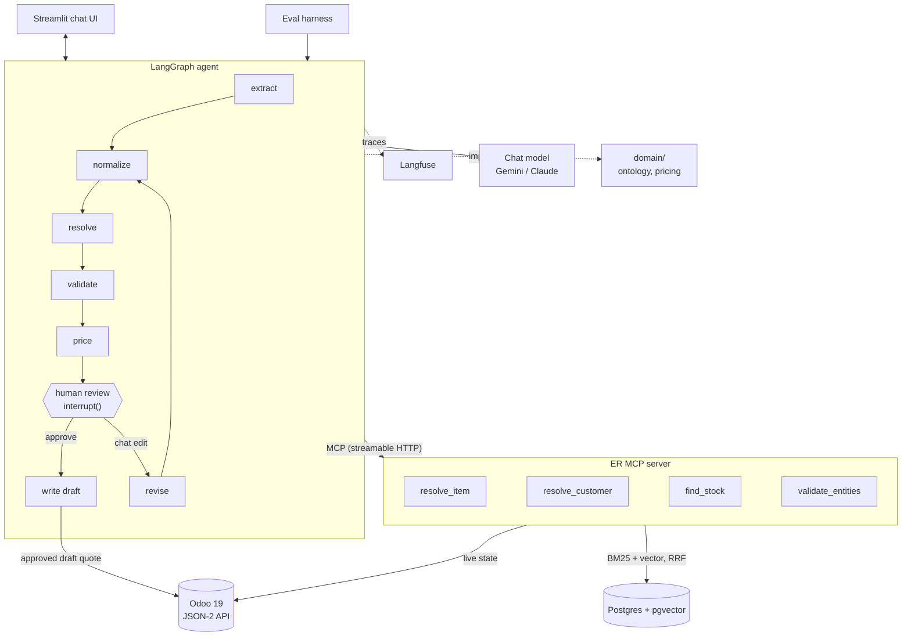

# Steel RFQ-to-Quote Copilot

A sales rep pastes a messy steel RFQ ("6 pcs 1/4 304 plt cut 24x24, certs required, ship Fri"). An agent extracts the lines, grounds every item against a **real ERP (Odoo 19)**, prices it deterministically, and, after a human approves, writes a **draft quotation** back into the ERP with an audit trail.

Built as a one-day prototype on synthetic inventory and public specs. The surcharges are real: the Cleveland-Cliffs stainless table for shipments Aug 30 – Oct 3, 2026.

## The principle
**The model reads and chooses. It never does math and never invents an ID.**

| The LLM does | Deterministic code does |
|---|---|
| Extract lines from the email | Normalize grades, fractions, mm, gauges (per material) into the ontology |
| Pick *from the ERP's candidate IDs*, or abstain | Retrieve candidates (BM25 + vector, RRF), validate against live stock |
| Turn a chat edit ("make line 2 3/16") into a patch | Weight, surcharge, cuts, certs, tier discounts, totals |

## Architecture

- **ER MCP server** (`er_server/`): `resolve_item`, `resolve_customer`, `find_stock` (remnant-first, live), `validate_entities` (live, catches stale/hallucinated IDs). The same grounding pattern I run in production at Blue Yonder, rebuilt for steel.
- **Agent** (`agent/`): LangGraph with a human-review `interrupt()`. Edits re-run only the changed lines. A line that fails validation gets one retry with relaxed search, then asks for clarification.
- **Domain** (`domain/`): ontology (grade aliases and UNS, fractions, gauge tables per material, densities, weights) and pricing. Pure functions, no I/O, unit-tested.
- **Odoo**: products, lots (heat numbers), remnants, customers with tiers. Custom `x_` fields were created over the API, so no addon module is needed. The agent only writes **draft** quotes, with an audit note in the chatter. A person confirms in Odoo.

## Run it
```bash
cp .env.example .env            # add ANTHROPIC_API_KEY (+ LANGFUSE_* for tracing/evals)
docker compose up -d            # Odoo 19 + Postgres/pgvector
uv sync
uv run python -m seed.seed_odoo                     # ~250 SKUs, ~730 lots, 20 customers
uv run python -m steelquote.er_server.server &      # MCP server on :8765
uv run streamlit run src/steelquote/app/main.py
uv run python -m steelquote.agent.cli evals/hero.txt --approve   # or from the terminal
uv run pytest
```
The Odoo database `steel`, its API key, and the admin test login are local-dev only.

## Evals
`evals/rfqs.jsonl`: 40 synthetic RFQs built **gold-first** (sample real in-stock items, write the answer, then render a messy email): clean, aliases and units, ambiguous (gauge vs fraction, grade missing), out-of-stock, missing dimensions, chatty multi-line.

`uv run python -m evals.run --all` compares configurations (each also a Langfuse experiment run when keys are set): **ungrounded** (the model writes the SKU itself), retrieval mode (keyword / vector / hybrid), validate-retry off, and model size. Metrics: line F1, SKU accuracy, correct abstention, quote $ error, $/RFQ, p50 latency. Runs on the Gemini free tier with `gemini-3.5-flash-lite` for every step.

### Results (40 synthetic RFQs, `gemini-3.5-flash-lite` for every step)
| config | line F1 | SKU acc | abstain | price err | $/RFQ* | p50 s | errors |
|---|---|---|---|---|---|---|---|
| lite | 0.977 | 0.952 | 1.0 | 0.006 | $0.00067 | 15.5 | 0 |
| ungrounded | 0.5 | 0.387 | 0.75 | 0.093 | $0.00069 | 30.1 | 0 |
| keyword | 0.927 | 0.881 | 1.0 | 0.077 | $0.0006 | 15.0 | 1 |
| vector | 0.947 | 0.905 | 1.0 | 0.041 | $0.00061 | 15.8 | 0 |
| no_retry | 0.957 | 0.917 | 1.0 | 0.018 | $0.00056 | 15.3 | 0 |

\* List-price equivalent; the free tier was used, actual spend $0. Latency is inflated by a deliberate free-tier rate limiter.

What the numbers say:
- **Grounding is not optional.** When the model writes the SKU itself, SKU accuracy falls from 0.95 to 0.39 and line F1 from 0.98 to 0.50. The ERP candidate list and live validation are what make the model usable.
- **Hybrid retrieval beats either half:** line F1 0.977 vs vector 0.947 vs keyword 0.927. Exact codes (S30400) favor keyword, paraphrase ("18-8 sheet") favors vectors.
- **The validate-and-retry loop** adds about 2 points (0.957 → 0.977). With 40 items that is roughly one line, so treat it as directional.
- Abstention scores 1.0, but that metric is lenient: it checks that at least as many lines were held back as should be, not that they are the same lines. The items are also generated, so real emails will be harder.

Not completed: a bigger-model comparison. `gemini-3.8-flash` failed all 40 requests (504/503 overload on the free tier at test time), and Pro models are not on the free tier, so there is no per-step model-routing result yet. The harness supports it (`--config flash`); rerun when the endpoint is healthy.

## Taking this to a real client ERP
1. Replace the seed with a read-only sync of their item master, lots and customer part-number cross-references; keep `validate_entities` hitting live state.
2. Price book freshness: surcharges and base prices load from the ERP or a dated table, not code.
3. Ingest from the quoting inbox (email, PDF); keep the human approve step until the override rate is low enough to earn autonomy.
4. Per-client config: the ontology, gauge conventions, tiers, and units live in data files; the graph and eval harness carry over unchanged.

## Roadmap
MTR (mill test report) extraction and matching to heat numbers · LoRA-tuned small extractor trained on approved corrections exported from Langfuse (decide with the same experiments) · multi-warehouse allocation · tax and freight from the ERP · email/PDF ingestion.

## Honest limits
Synthetic inventory, illustrative base prices (only the stainless surcharges are published figures), one warehouse, no tax, no PDF input.
